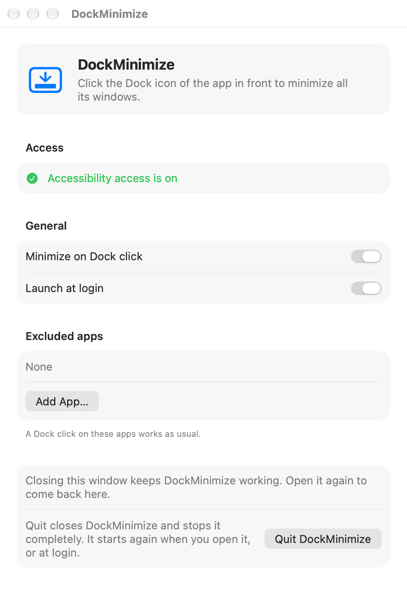

# DockMinimize

Click the Dock icon of the app you are using, and its windows minimize. Like the taskbar on Windows.

Free, open source, and it does that one thing.

<p align="center">
  <picture>
    <source media="(prefers-color-scheme: dark)" srcset="docs/settings-dark.png">
    
  </picture>
</p>

## Why I made it

On Windows you click an app in the taskbar to tuck it away. On a Mac, clicking the Dock icon of the app in front does nothing.

The apps that add this either cost money, like Click2Minimize, or bundle it with a lot more: window previews, app switchers, gestures, snapping. I wanted one small change to the Dock, for free, and nothing else.

So DockMinimize:

- changes one click and leaves the rest of the Dock alone
- has no menu bar icon, no account, no network access and no tracking
- is about 500 lines of Swift you can read in one sitting

## What it does

- **Click the Dock icon of the app in front:** all its windows minimize together. It uses the app's own Minimize All (⌥⌘M), so they animate at the same time. Apps without Minimize All get each window minimized in turn.
- **Every other click works as usual.** Click an app in the back to switch to it. Click an app whose windows are minimized and macOS brings the last one back.
- **Hold any modifier key** (⌘ ⌥ ⌃ ⇧) for the normal Dock click, for example to drag an icon.
- **Exclude apps** that should keep the normal click.

## Install

Needs macOS 13 or later, on Apple Silicon or Intel.

1. Download `DockMinimize-<version>.dmg` from the [latest release](https://github.com/SameerCrestha/dock-minimize/releases/latest).
2. Open it and drag **DockMinimize** to **Applications**.
3. Open DockMinimize from Applications. The first time, macOS blocks it with "Apple could not verify…". This is because the app is not notarized, which needs a paid Apple developer account.
   - Click **Done**.
   - Go to System Settings → **Privacy & Security**, scroll down, and click **Open Anyway** next to DockMinimize.
   - Confirm with **Open Anyway** and your password. You only do this once.
4. The DockMinimize window opens. Under **Access**, click **Open Accessibility Settings** and switch **DockMinimize** on. The window turns green.
5. That's it. Close the window and DockMinimize keeps working. It also starts at login.

## Use

- Open DockMinimize again (Launchpad, Spotlight or Applications) to see its window. From there you can:
  - check Accessibility access
  - turn it off, or stop it starting at login (on by default)
  - exclude apps
  - quit it
- Closing the window, ⌘Q or Quit in the Dock only close the window. DockMinimize keeps working.
- The **Quit DockMinimize** button closes it and stops it completely, until you open it again or log in.

## Update

Download the new `.dmg` and replace the app in Applications. Accessibility access stays on, because every release is signed with the same certificate.

If the window says it needs access while the switch is already on, select DockMinimize in the Accessibility list, click **−**, then **+** to add it again.

## Uninstall

1. Open DockMinimize and click **Quit DockMinimize**.
2. Drag it from Applications to the Trash.
3. Optional: remove it from System Settings → Privacy & Security → **Accessibility**, and from General → **Login Items**.

## FAQ

**Why does it need Accessibility access?**
To see which Dock icon you clicked, and to minimize windows. It has no network code, so nothing leaves your Mac.

**Why does a second click bring back only one window?**
That is what macOS does. DockMinimize only changes the click that minimizes, and leaves bringing windows back to the Dock.

**An app minimizes its windows one by one.**
That app has no Minimize All, so DockMinimize minimizes each window itself. Add it to Excluded apps if you prefer the normal click there.

**Does it work with "Minimize windows into application icon"?**
Yes, with that setting on or off.

## Build from source

Needs the Xcode Command Line Tools (`xcode-select --install`).

```sh
scripts/run-local.sh     # build, clear the old Accessibility grant, start the app
scripts/build-app.sh     # build build/DockMinimize.app
scripts/make-dmg.sh      # pack it into build/DockMinimize-<version>.dmg
scripts/screenshot.sh    # render the settings window into docs/ for this README
```

### Signing

macOS ties the Accessibility grant to the app's signature. Builds signed with the same certificate keep the grant across rebuilds and updates. An ad-hoc build loses it every time.

The build script signs with a self-signed "DockMinimize Signing" certificate from `~/.config/dock-minimize/signing.p12` (password in `signing.pass`). It uses a throwaway keychain, so the login keychain is not touched. Without the file it signs ad-hoc, and `run-local.sh` then clears the old grant so you get a fresh prompt.

Keep the .p12 private. Anyone with it could sign an app that inherits DockMinimize's Accessibility grant.

To create one:

```sh
mkdir -p ~/.config/dock-minimize && cd ~/.config/dock-minimize
printf '[req]\ndistinguished_name=dn\nx509_extensions=ext\nprompt=no\n[dn]\nCN=DockMinimize Signing\n[ext]\nbasicConstraints=critical,CA:false\nkeyUsage=critical,digitalSignature\nextendedKeyUsage=critical,codeSigning\n' > cert.cnf
/usr/bin/openssl rand -hex 24 > signing.pass
/usr/bin/openssl req -x509 -newkey rsa:2048 -nodes -days 3650 -config cert.cnf -keyout key.pem -out cert.pem
/usr/bin/openssl pkcs12 -export -inkey key.pem -in cert.pem -name "DockMinimize Signing" -out signing.p12 -passout file:signing.pass
rm cert.cnf key.pem cert.pem && chmod 600 signing.*
```

Logs:

```sh
/usr/bin/log stream --level info --predicate 'subsystem == "io.github.sameercrestha.dockminimize"'
```

## Release

Push a version tag. GitHub Actions builds a universal app, signs it with the same certificate, and attaches the `.dmg` to a new release.

The workflow needs two repository secrets (Settings → Secrets and variables → Actions):

- `SIGNING_P12_BASE64`: output of `base64 -i ~/.config/dock-minimize/signing.p12`
- `SIGNING_P12_PASSWORD`: contents of `~/.config/dock-minimize/signing.pass`

```sh
git tag v0.1.0 && git push origin v0.1.0
```

## How it works

A Core Graphics event tap sees each left click. On mouse down it asks the Dock (through the Accessibility API) which icon is under the pointer. If it acts, it swallows the click so the Dock does not undo it.

It presses the app's hidden Minimize All menu item, or sends ⌥⌘M, so every window animates together. Any window that is still open after that gets `kAXMinimizedAttribute` set.

## License

MIT
